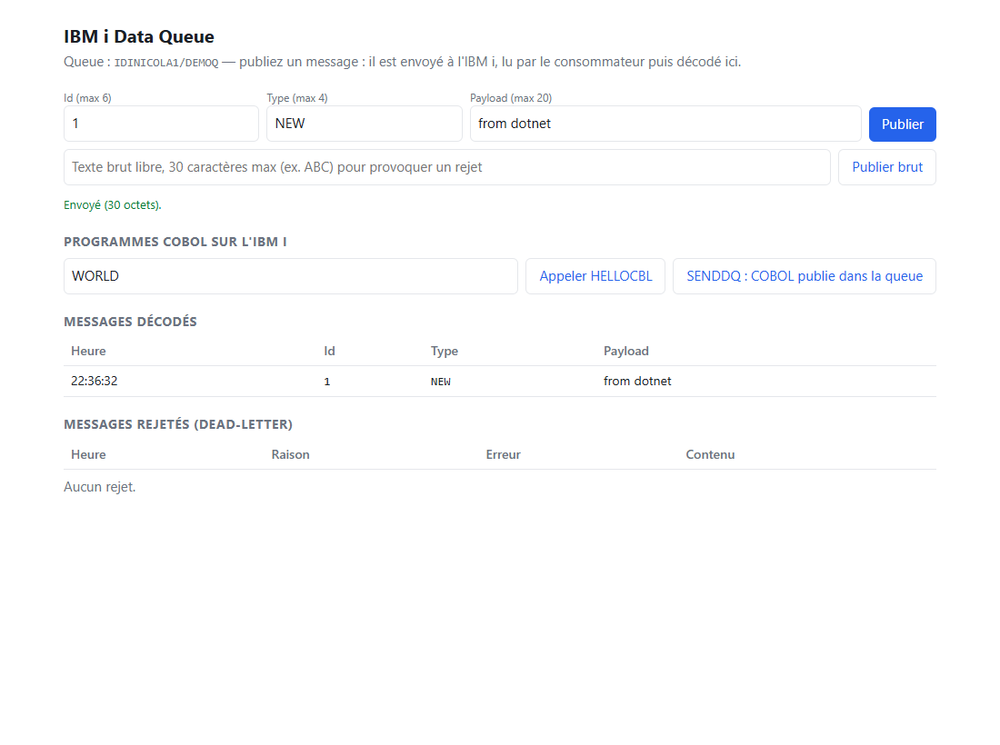
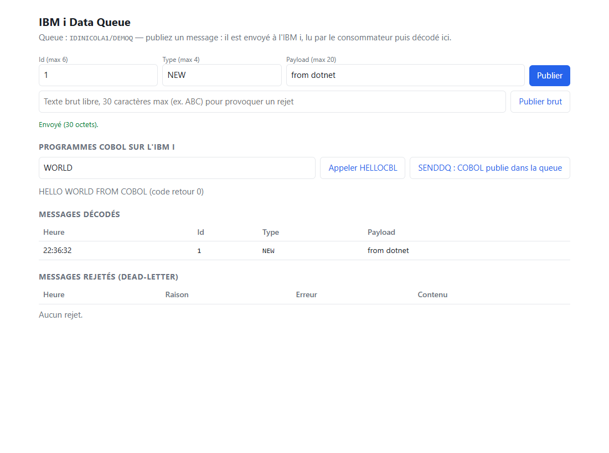
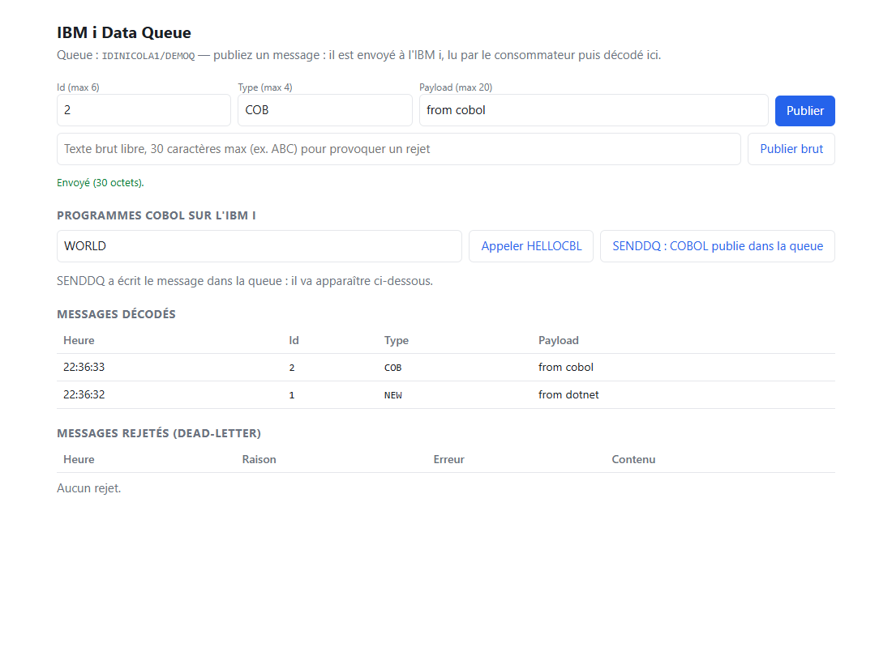
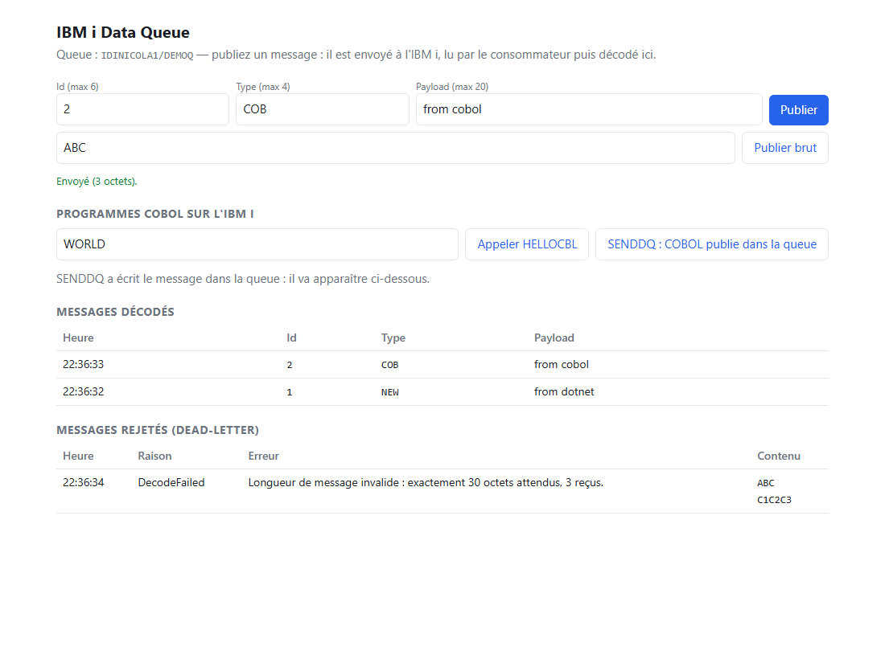

# IbmiDataQueue

Consommer une data queue IBM i depuis .NET sans réécrire à chaque fois la boucle de lecture, le découpage des messages, le retry et la gestion des messages en erreur.

La bibliothèque ne connaît que des **octets** et des **points d'extension**. Le métier (une facture, une commande...) est un simple plugin.

## Projets

| Projet | Rôle | Dépendances |
|---|---|---|
| `IbmiDataQueue.Core` | Interfaces, pipeline (recevoir → décoder → traiter), retry, dead-letter, télémétrie, `FixedWidthLayout` | aucune |
| `IbmiDataQueue.Testing` | Data queue et dead-letter en mémoire, handler à base de lambda | Core |
| `IbmiDataQueue.Sql` | Lecture via `QSYS2.RECEIVE_DATA_QUEUE` sur n'importe quel `DbConnection` | Core |
| `IbmiDataQueue.FileSystem` | Dead-letter (JSON) et état du disjoncteur sur disque : exemple sans base de données | Core |
| `IbmiDataQueue.SqlServer` | Dead-letter et état du disjoncteur dans SQL Server (connexion fournie par l'appelant) | Core |
| `IbmiDataQueue.Hosting` | `BackgroundService` + `AddDataQueueConsumer<T,...>()` | Core, Microsoft.Extensions.Hosting.Abstractions |

## Points d'extension

```csharp
IDataQueueClient      // lit une queue (SQL, mémoire...)
IMessageCodec<T>      // octets -> T
IMessageHandler<T>    // traitement métier
IDeadLetterSink       // destination des messages non traités (doit être durable)
IDeadLetterStore      // dead-letter qu'on peut aussi lister et supprimer (FileSystem, SqlServer)
ICircuitBreakerStore  // état partagé d'un disjoncteur (mémoire, fichiers, SQL Server) : compare-and-swap sur une version
```

## Garanties

- Le message est **retiré de la queue à la lecture** (`REMOVE => 'YES'`) : livraison « au plus une fois ».
- Pour ne rien perdre, tout message reçu est soit traité, soit écrit dans le dead-letter :
  - décodage refusé (longueur, format) : dead-letter `DecodeFailed`, sans retry ;
  - handler en échec : retry (3 essais par défaut, backoff exponentiel), puis `HandlerFailed` ;
  - arrêt demandé pendant le traitement : dead-letter `Interrupted`, puis l'annulation se propage.
- Si le dead-letter lui-même échoue, l'exception remonte (message perdu, mais erreur visible).
- **Vous devez fournir un `IDeadLetterSink` durable** (table Db2, fichier...). Celui en mémoire sert aux tests.

## Utilisation

```csharp
services.AddSingleton<IDataQueueClient>(new SqlDataQueueClient(async ct =>
{
    var connection = new MyDb2Connection(connectionString);
    await connection.OpenAsync(ct);
    return connection;
}));
services.AddSingleton<IDeadLetterSink, MyDb2DeadLetterSink>();
services.AddDataQueueConsumer<InvoiceRequest, InvoiceRequestCodec, InvoiceRequestHandler>(
    new QueueRef("MYLIB", "INVOICEQ"),
    options => options.Wait = TimeSpan.FromSeconds(30));
```

Codec à largeur fixe (largeurs en **octets**, encodage mono-octet du job émetteur, par exemple IBM500) :

```csharp
Encoding.RegisterProvider(CodePagesEncodingProvider.Instance);
var layout = new FixedWidthLayout(Encoding.GetEncoding("IBM500"), [10, 10, 2]);
var fields = layout.Read(payload); // longueur exacte exigée, champs sans remplissage
```

Télémétrie : `AddSource(DataQueueTelemetry.Name)` et `AddMeter(DataQueueTelemetry.Name)` (OpenTelemetry).

## Résilience et plusieurs instances

La lecture retire le message : si la dépendance en aval (base, API) est en panne, on ne veut ni perdre les messages ni les vider vers le dead-letter.

- **Erreur transitoire** (timeout, E/S, `HttpRequestException`, `DbException.IsTransient`, ou votre `IsTransient`) : le message reste en main et est rejoué avec backoff, jusqu'à `MaxTransientHold` (30 min par défaut), puis dead-letter. Elle ne consomme pas `MaxHandlerAttempts`.
- **Erreur permanente** (bug, message invalide) : `MaxHandlerAttempts` essais puis dead-letter ; elle n'ouvre jamais le disjoncteur.
- **`HandlerBreaker`** : après `FailureThreshold` échecs transitoires consécutifs, le disjoncteur s'ouvre et **plus aucune lecture n'est faite** : les messages restent dans la data queue IBM i. Après `BreakDuration` (+ jitter), une seule sonde est autorisée (demi-ouvert) ; son succès referme.
- **`ReceiveBreaker`** : même mécanisme pour les erreurs de lecture IBM i.
- **Plusieurs instances, un seul groupe de consommateurs** : les instances lisent la même queue, chaque message va à une seule d'entre elles. Avec un `ICircuitBreakerStore` partagé (SQL Server ou dossier commun) elles partagent aussi le disjoncteur et une seule instance fait la sonde. Avec `InMemoryCircuitBreakerStore`, chaque instance a son propre disjoncteur.
- `Concurrency` = nombre de boucles de lecture par instance ; chacune ne lit que lorsqu'elle est libre (pas de prélecture). Connexions IBM i tenues pendant `Wait` : instances x `Concurrency`.
- Si le store du disjoncteur est indisponible, le disjoncteur **laisse passer** (`OnError` est appelé).
- `FallbackDeadLetterSink(primaire, repli)` : par exemple SQL Server puis dossier local si la base est tombée.

```csharp
var breakers = new SqlServerCircuitBreakerStore(OpenSqlServer, new SqlServerTable("DqCircuitBreaker"));
services.AddSingleton<IDeadLetterSink>(new FallbackDeadLetterSink(
    new SqlServerDeadLetterStore(OpenSqlServer, new SqlServerTable("DqDeadLetter")),
    new FileSystemDeadLetterStore(@"D:\dq\deadletter")));
services.AddDataQueueConsumer<InvoiceRequest, InvoiceRequestCodec, InvoiceRequestHandler>(
    new QueueRef("MYLIB", "INVOICEQ"),
    (provider, options) =>
    {
        options.Concurrency = 2;
        options.HandlerBreaker = new CircuitBreaker("invoice-db", breakers);
    });
```

Les tables SQL Server se créent avec `SqlServerSchema.DeadLetterTable(...)` / `CircuitBreakerTable(...)` dans vos migrations.

### Limites à connaître

- Ce qui est **déjà lu** quand le process est tué net (kill, coupure) est perdu : c'est la nature de `REMOVE => 'YES'`. Le dead-letter `Interrupted` ne couvre que l'arrêt propre. Le vrai filet de sécurité reste métier (table de travail, rapprochement, handlers idempotents).
- L'ordre des messages n'est pas garanti entre instances ni entre boucles.
- `FileCircuitBreakerStore` repose sur des verrous de fichier : fiable sur un disque local, pas sur tous les partages réseau.
- Les implémentations SQL Server n'ont **pas été exécutées contre un vrai serveur** par l'auteur (les tests existent mais sont ignorés sans `SQLSERVER_CONNECTION_STRING`).

## Tester

- `dotnet test --filter Category!=Integration` : tests unitaires (aucun IBM i requis) en domaine neutre « Echo ».
- Cible par défaut : `net11.0`. Pour un SDK plus ancien : `dotnet build -p:DqTfm=net10.0`.

### Tests d'intégration (vrai IBM i)

Projet `IbmiDataQueue.IntegrationTests`. Sans les variables d'environnement ci-dessous, les tests sont **ignorés** (ils n'échouent pas).

| Variable | Rôle |
|---|---|
| `IBMI_HOST` | Hôte IBM i (ex. serveur public PUB400) |
| `IBMI_USER`, `IBMI_PASSWORD` | Identifiants (jamais dans le code) |
| `IBMI_LIBRARY` | Bibliothèque **existante** où créer les queues de test |
| `IBMI_CONNECTION_STRING` | Optionnel : remplace HOST/USER/PASSWORD |
| `IBMI_ODBC_DRIVER` | Optionnel, défaut `IBM i Access ODBC Driver` |
| `IBMI_CODEPAGE` | Optionnel, EBCDIC du job, défaut `37` (500, 1148...) |

```bash
export IBMI_HOST=... IBMI_USER=... IBMI_PASSWORD=... IBMI_LIBRARY=...
dotnet test tests/IbmiDataQueue.IntegrationTests --filter Category=Integration
```

Chaque test crée sa data queue (30 octets, FIFO) avec `QSYS2.QCMDEXC('CRTDTAQ ...')`, l'alimente avec `QSYS2.SEND_DATA_QUEUE_BINARY` (ou `SEND_DATA_QUEUE` pour le texte) puis la supprime. **Aucun programme COBOL, physical file ni terminal n'est nécessaire.**

Prérequis : driver ODBC d'IBM i Access installé (et unixODBC sous Linux). Pour `IBM.Data.Db2`, remplacer uniquement `IntegrationConnection.cs`.

Ce que les tests vérifient :
1. Un message binaire ressort identique (aller-retour).
2. **Une queue vide renvoie zéro ligne après l'attente** : hypothèse centrale de `SqlDataQueueClient`. Si ce test échoue, corriger `ReceiveAsync`.
3. Le pipeline traite un message valide, envoie un message invalide au dead-letter, puis signale la queue vide.
4. Un message texte est converti dans le CCSID du job : ajuster `IBMI_CODEPAGE` si besoin.

> Ces 4 tests ont été exécutés avec succès contre le serveur public PUB400 (pilote ODBC Linux dans Docker, voir ci-dessous).

### Sous Windows sans le pilote IBM : Docker

Le pilote Windows (IBM i Access Client Solutions) demande un compte IBM ; le pilote Linux, lui, est public. Le dossier `.devcontainer/` contient l'image Docker (`unixODBC` + `ibm-iaccess`) :

- `debug-tests.ps1` lance les tests d'intégration dans le conteneur et attend Visual Studio (Debug > Attach to Process > Docker (Linux Container) > `dqtest`).
- `run-demo.ps1` lance l'application de démonstration (ci-dessous) sur http://localhost:5080.
- `IBMI_PASSWORD` est lu dans la variable d'environnement utilisateur Windows ; l'hôte, l'utilisateur et la bibliothèque sont en tête des scripts.

## Application de démonstration

`samples/IbmiDataQueue.Demo.Web` : une page web pour publier un message dans une data queue (`IDINICOLA1/DEMOQ`, créée au démarrage), le voir lu par le consommateur et décodé (Id 6 + Type 4 + Payload 20 = 30 octets **EBCDIC**), ou rejeté en dead-letter avec ses octets.

### En images

**1. Publier depuis .NET (publish / subscribe)** : le message part dans la data queue de l'IBM i, le consommateur .NET le lit et le décode.



**2. Appeler le programme COBOL `HELLOCBL`** : `CALL HELLOCBL(?, ?, ?)` par ODBC ; la salutation et le code retour reviennent dans les paramètres de sortie.



**3. Le COBOL publie lui-même (`SENDDQ`)** : le programme écrit dans la queue avec `QSNDDTAQ`, le consommateur .NET le décode comme n'importe quel autre message (ligne `2 / COB`).



**4. Message invalide → dead-letter** : un message de 3 octets au lieu de 30 est rejeté, avec ses octets en texte et en hexadécimal (EBCDIC : `ABC` = `C1C2C3`).



Les captures sont générées par un script Playwright qui pilote la page ; elles ne contiennent aucun identifiant.

Deux programmes COBOL de démonstration (`ibmi/*.cbl`) sont appelés depuis .NET :

| Programme | Procédure SQL | Rôle |
|---|---|---|
| `HELLOCBL` | `HELLOCBL(IN P_NAME, OUT P_GREET, OUT P_RC)` | Renvoie une salutation et un code retour (`/api/hello`). |
| `SENDDQ` | `SENDDQ(IN P_ID, IN P_TYPE, IN P_PAYLOAD)` | Écrit un message dans la data queue avec `QSNDDTAQ` ; le consommateur .NET le décode (`/api/cobol-send`). |

`install-ibmi.ps1` crée les membres source dans `QCBLLESRC`, compile avec `CRTBNDCBL` et déclare les procédures SQL (`LANGUAGE COBOL`, `PARAMETER STYLE GENERAL`). `SENDDQ` est codé en dur pour la queue `IDINICOLA1/DEMOQ` : adapter `DQ-LIB` et `DQ-NAME` dans `ibmi/SENDDQ.cbl`. Limite connue de `HELLOCBL` : le nom est coupé au premier espace (`DELIMITED BY SPACE`).

## Prochaines étapes

- Tests SQL Server à lancer (`SQLSERVER_CONNECTION_STRING`, base jetable) ; variante SQLite des stores.
- Table d'« en cours de traitement » partagée pour réduire la fenêtre de perte entre lecture et traitement.
- Dead-letter Db2 et émetteur `QSYS2.SEND_DATA_QUEUE`.
- Tests de contrat identiques sur le client en mémoire et sur le client SQL.
- Test avec une fausse `DbConnection` pour `SqlDataQueueClient`.
- Health check et décodage des champs packed decimal (COMP-3) / zoned.
